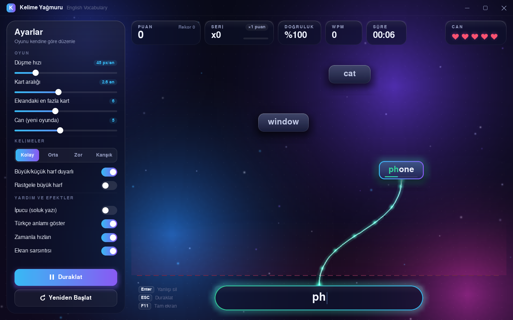

# Kelime Yağmuru

Python ve pygame ile yazılmış bir İngilizce kelime yazma oyunu. Üstten içinde İngilizce kelime yazan kartlar düşer; en alttaki kartın kelimesini klavyeden doğru yazınca kart parçalanarak patlar ve Türkçe anlamı ekranda görünür.



## Özellikler

- Hedef her zaman en alttaki karttır; yazma kutusuyla arasında bir ışık hattı çekilir.
- Doğru yazılan harfler kartın içinde yeşile döner, yanlış yazınca hat ve kutu kırmızıya döner.
- Kart kırmızı çizgiye değerse bir can gider; seri yaptıkça puan çarpanı artar.
- Oyun sonunda kaçırılan kelimeler Türkçe anlamlarıyla listelenir.
- Sol panelden ayarlanabilir: düşme hızı, kart aralığı, ekrandaki en fazla kart, can sayısı, kelime seviyesi (Kolay / Orta / Zor / Karışık), büyük/küçük harf duyarlılığı, ipucu, Türkçe anlam, zamanla hızlanma, ekran sarsıntısı.
- Çerçevesiz modern pencere, cam efektli paneller, parçacık ve patlama efektleri.

## Kurulum ve çalıştırma

```
pip install -r requirements.txt
python kelime_yagmuru.py
```

Python 3.9 veya üzeri gerekir. Klasik `pygame` paketiyle de çalışır (`pip install pygame`).

## Kısayollar

| Tuş | İşlev |
|---|---|
| Enter | Oyunu başlat / yanlış yazılanı sil |
| ESC | Duraklat / devam et |
| F11 | Tam ekran aç / kapat |
| Backspace | Son harfi sil |
| Ctrl + Backspace | Yazılanı tamamen sil |

Pencere, üstteki başlık çubuğundan sürüklenerek taşınabilir; başlık çubuğuna çift tıklamak tam ekrana geçirir.

## Kendi kelimelerini eklemek

Oyun dosyasının yanına `words.txt` adlı bir dosya koy. Her satıra bir kelime ve Türkçe anlamını noktalı virgülle ayırarak yaz:

```
apple;elma
journey;yolculuk
```

Bu kelimeler ayarlardaki **Özel** seviyesinde çıkar.
